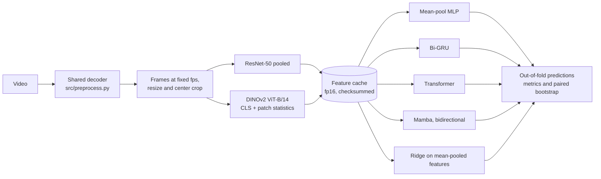

# Testcard

**Where does the quality signal live? Cached features versus temporal heads for no-reference video quality.**

A controlled comparison of four temporal heads and a ridge baseline on frozen, cached backbone features for no-reference video quality assessment (NR-VQA). The models were trained on KoNViD-1k and tested on LIVE-VQC, and a small CPU demo scores an uploaded clip.


## TL;DR

- **Question.** For NR-VQA on cached features, does the choice of temporal head (mean pooling, Bi-GRU, Transformer, Mamba) matter, or does the feature representation carry the signal?
- **Heads.** On KoNViD-1k with {{chosen}} features, {{head_verdict}}. Of {{n_pairs}} head pairs, {{n_detectable}} showed a detectable difference not shown to exceed the ±{{margin}} SRCC margin, and {{n_inconclusive}} showed no detectable difference. Ridge regression on mean-pooled features was {{ridge_tldr}}.
- **Features.** {{feature_verdict}}, by the paired bootstrap and the ±{{margin}} margin rule.
- **Layers (post-hoc, exploratory, unadjusted).** Patch statistics from DINOv2 block 6 {{l6_phrase}} the ResNet-50 ridge (Δ SRCC {{l6_delta}}, 95% CI {{l6_ci}}). This was {{robust}} under a predeclared check with the ridge alpha grid extended to 1e6. The DINOv2 deficit was specific to the last layer used in the declared protocol.
- **Cross-dataset.** Trained on KoNViD-1k and tested on LIVE-VQC, {{live_verdict}}. The deployed ridge reached SRCC {{deployed_live_srcc}} on LIVE-VQC.
- **SOTA.** These cached-feature regressors sit below end-to-end trained models; {{sota_tldr}}.

## Contents

1. [Question](#question)
2. [Method](#method)
3. [Results: head comparison](#results-head-comparison)
4. [Results: feature ablation](#results-feature-ablation)
5. [Results: cross-dataset (LIVE-VQC)](#results-cross-dataset-live-vqc)
6. [Results: length extrapolation](#results-length-extrapolation)
7. [Post-hoc analysis: why DINOv2 lost to ResNet-50](#post-hoc-analysis-why-dinov2-lost-to-resnet-50)
8. [Gap to published SOTA](#gap-to-published-sota)
9. [Validity and audit trail](#validity-and-audit-trail)
10. [Limitations](#limitations)
11. [Demo](#demo)
12. [Quickstart and reproduction](#quickstart-and-reproduction)
13. [Repository layout](#repository-layout)
14. [Datasets and licenses](#datasets-and-licenses)
15. [Citation](#citation)
16. [Acknowledgements](#acknowledgements)

## Question

No-reference video quality models predict a mean opinion score (MOS) from a video alone. Many recent models pair a pretrained image backbone with a temporal module, and papers often credit the temporal module, lately state-space (Mamba-style) layers, for their gains. When the backbone and the head change together, the contribution of each is hard to separate. This project froze the backbones, cached their per-frame features once, and compared heads under one fixed protocol. That way, head and feature effects could be measured separately and with confidence intervals.

The research questions were fixed before training:

- **RQ1.** Does temporal ordering matter at all, comparing mean pooling with sequence models on the same features? *Answered* in the head comparison.
- **RQ2.** Does Mamba beat Bi-GRU and Transformer within KoNViD-1k (5-fold cross-validation)? *Answered* in the head comparison.
- **RQ3.** How much does the feature representation matter, comparing ResNet-50 with the fixed DINOv2 last-layer representation? *Answered* in the feature ablation, and extended by a post-hoc, exploratory, unadjusted layer analysis.
- **RQ4.** Do the heads generalize from KoNViD-1k to LIVE-VQC? *Answered* in the cross-dataset results.
- **RQ5.** Length extrapolation on YouTube-UGC. *Not answered*: cut from the 10-day scope (see [length extrapolation](#results-length-extrapolation)).

## Method



**Datasets.** The table describes both datasets as recorded in the committed manifests. The T column is the sequence length the heads see.

{{datasets_table}}

**Preprocessing.** Offline extraction and serving share one frozen policy (`src/preprocess.py`, `src/features.py`). The decoder applied rotation metadata and sampled frames at {{fps}} fps. Each frame was resized ({{interpolation}}, antialiased), center-cropped to {{crop}}×{{crop}} and normalized with ImageNet statistics. Offline extraction ran with `{{precision}}`; serving runs the same code in CPU fp32, and a parity check bounds the difference.

**Features.** The two backbones were ResNet-50 (torchvision `IMAGENET1K_V2`, global-pooled, 2048-d) and DINOv2 ViT-B/14. The declared DINOv2 representation was the last-layer CLS token plus the block-12 patch mean (1536-d). Patch means and standard deviations from blocks 6, 9 and 12 were also cached. Per the scope decision, they were not evaluated as separate variants until the post-hoc analysis.

**Heads.** Every neural head shares one front end (a linear projection with normalization) and differs only in its temporal module. Head-only trainable parameters were matched across heads; the table shows both counts. Every head masks padding, and bidirectional heads reverse each sequence within its valid length. A padding-invariance test covers every head.

{{params_table}}

The largest head-only count was {{head_param_spread}} above the smallest.

**Training and tuning.**
- **Loss:** L1 on z-scored MOS plus a pairwise rank term with one shared weight ({{rank_weight}}).
- **Tuning:** done once, on fold 0 with its inner-validation split, and on the DINOv2 representation only. The rank weight was tuned first, with the mean-pool head, then {{trials}} candidates per head. The frozen configurations were reused on ResNet-50 without re-tuning.
- **Training runs:** each neural head ran 5 outer folds × {{n_seeds}} seeds, with early stopping on the inner-validation split (at most {{max_epochs}} epochs, patience {{patience}}).
- **Baseline 0:** ridge regression on mean-pooled features ran once per fold, with alpha chosen on inner validation from {{{alpha_grid}}}.
- **Control:** a shuffled-label control accompanied each pipeline (see [validity](#validity-and-audit-trail)).

**Statistics.**
- **Headline number:** the mean and SD of per-fold SRCC across fold × seed runs. Ridge is deterministic, so for ridge it is the mean and SD across folds.
- **Comparisons:** a paired bootstrap over videos (10,000 draws, seed 0) on pooled out-of-fold predictions, averaged across seeds. Each difference is classified against a ±{{margin}} SRCC margin, checking in this order: equivalent within margin; practically meaningful; detectable but not shown to exceed the margin; no detectable difference.
- **Families:** the six head pairs form the primary family on each dataset, with Holm-adjusted p-values. All other comparisons are secondary and unadjusted.
- **What the intervals cover:** the bootstrap captures test-set sampling noise only, not fold or training variance, so the intervals are optimistic. They describe the seed-averaged ensemble, not the headline mean.
- **PLCC:** reported after a 4-parameter logistic fit, and never bootstrapped.

## Results: head comparison

The head comparison used {{chosen}} features, chosen on inner-validation SRCC (see [feature ablation](#results-feature-ablation)). The table gives each head's headline accuracy. Read differences from the pairwise table below rather than by comparing rows.

{{head_table}}

The pairwise table classifies each A − B difference on pooled out-of-fold predictions; the ridge rows are secondary comparisons.

{{pair_table}}


None of the {{n_pairs}} primary head pairs reached the practically meaningful category, and {{n_equivalent}} were equivalent within the margin. The detectable differences were: {{detectable_pairs}}. The remaining {{n_inconclusive}} pairs showed no detectable difference. So the sequence heads did not beat mean pooling by more than the margin (RQ1), and Mamba did not beat the Bi-GRU or the Transformer by more than the margin (RQ2). {{ridge_vs_heads}}. On these cached features, temporal modelling added nothing measurable over mean pooling, and no trained head beat a linear model on pooled features.

## Results: feature ablation

Feature selection used inner-validation SRCC: the mean was {{val_dino}} for DINOv2 and {{val_resnet}} for ResNet-50, so ResNet-50 was selected. The inner-validation videos came from the same KoNViD-1k videos as the head comparison. Each fold validated on {{overlap_per_fold}} videos ({{overlap_rows}} validation rows across folds). In total, **{{overlap_videos}} of {{overlap_total}} videos ({{overlap_fraction}})** were used for inner-validation selection while also being held-out test videos in another fold ([inner_val_overlap.json](results/inner_val_overlap.json)). The selection never used held-out scores, but it did use the same videos.

The table compares each head on the two feature sets; the classification column gives the effect of the features alone.

{{feature_table}}


{{feature_verdict}}, by a larger margin than any head difference: the representation mattered much more than the temporal head. A DINOv2 layer comparison was not part of the predeclared protocol. It is reported separately in the [post-hoc analysis](#post-hoc-analysis-why-dinov2-lost-to-resnet-50) and labelled post-hoc, exploratory and unadjusted.

## Results: cross-dataset (LIVE-VQC)

After the KoNViD configuration was frozen, every model was refit on all of KoNViD-1k and evaluated once on all {{n_live}} LIVE-VQC videos. SRCC and KRCC are computed on raw predictions; PLCC is computed after a 4-parameter logistic fit to the LIVE-VQC labels. Neural rows are means over seeds, and ridge rows are single deterministic fits.

{{live_table}}

The primary family compares the {{chosen}} heads on LIVE-VQC; read it like the KoNViD pairwise table.

{{live_pair_table}}

On LIVE-VQC, {{live_verdict}}, so the head conclusions carried over. Accuracy fell from KoNViD-1k to LIVE-VQC: the deployed ridge scored {{deployed_konvid_srcc}} mean per-fold SRCC within KoNViD-1k and {{deployed_live_srcc}} SRCC on LIVE-VQC (PLCC {{deployed_live_plcc}} after mapping). These are different quantities: a cross-validation mean and a single transfer evaluation. The model fell short because LIVE-VQC has more varied devices, more portrait video and longer sampled sequences. The center crop also discards more of each portrait frame.

## Results: length extrapolation

Not done. YouTube-UGC, and with it RQ5 (length extrapolation), was cut from the 10-day scope; see the scope entries in [DECISIONS.md](DECISIONS.md). No length-generalization claim is made.

## Post-hoc analysis: why DINOv2 lost to ResNet-50

Everything in this section is **post-hoc, exploratory and unadjusted**, chosen after the Phase 1–3 results were known. Both parts were predeclared in [DECISIONS.md](DECISIONS.md) before any computation: the layer analysis in commit `{{predeclare_a}}` and the alpha-grid follow-up in commit `{{predeclare_grid}}`. Nothing here changed the deployed model or any phase result, because choosing a model from these held-out results would be test-set selection.

**Part A (post-hoc, exploratory, unadjusted).** Five DINOv2 variants were fitted with the Phase 1/2 ridge protocol. Variant A0 reproduced the original DINOv2 ridge in every fold (maximum absolute SRCC difference {{a0_repro}}), so the comparison is like-for-like. The table shows the five variants under the original alpha grid.

{{parta_table}}

In Part A, {{parta_edge}} of {{parta_folds}} variant-folds chose the top of the original alpha grid. That left open whether every DINOv2 ridge, including the original, was under-regularized.

**Alpha-grid follow-up (post-hoc, exploratory, unadjusted).** All variants and the ResNet-50 ridge were refit with the grid extended to {{grid_values}}. The table shows the mean ± SD over five folds and each fold's chosen alpha.

{{grid_table}}


The predeclared robustness rule had two conditions: the L6 − ResNet-50 SRCC interval must exclude zero, and no row may choose the largest grid value in more than one of five folds.
- L6 − ResNet-50 was {{l6_delta}} (95% CI {{l6_ci}}, {{l6_class}}).
- The most folds any row placed at 1e6 was {{worst_edge}}.

So the L6 finding was **{{robust}}** (post-hoc, exploratory, unadjusted). The original Phase 2 ResNet-50 ridge had also chosen the edge of the original grid in {{resnet_old_edge}} of 5 folds. On LIVE-VQC (post-hoc, exploratory, unadjusted, never fed back), L6 scored SRCC {{live_l6}}, ALL scored {{live_all}}, and the extended-grid ResNet-50 ridge scored {{live_resnet_grid}}.

**Part B, descriptive only (post-hoc, exploratory, unadjusted).** Frames were blurred, noised and JPEG-compressed, and each branch's feature change was measured relative to the variation between clean frames:
- ResNet-50 reacted most (mean ratio {{ratio_resnet}}).
- DINOv2 block-6 patch means reacted less ({{ratio_l6}}).
- Block-12 patch means reacted least ({{ratio_l12}}).

ResNet-50 is the most distortion-sensitive, yet it loses to L6, so raw sensitivity is not the mechanism. The evidence from Part B is mixed.

**Reading (post-hoc, exploratory, unadjusted).** Quality information carried by the earlier DINOv2 layers was largely lost by the last layer, which is the only layer the original protocol used. The feature-ablation conclusion therefore holds for the declared DINOv2 representation, not for DINOv2 in general. Limitations: several variants and unadjusted comparisons, a follow-up chosen after seeing the grid-edge result, and intervals that cover test-set noise only. Full reports: [layer analysis](results/posthoc_dino/report.md) and [alpha-grid follow-up](results/posthoc_dino/grid_followup/report.md).

## Gap to published SOTA

Published numbers come only from the original papers, with their split and protocol, as listed in [results/sota_citations.csv](results/sota_citations.csv).

{{sota_table}}

The published protocols differ from this project's: 5-fold cross-validation within KoNViD-1k, plus a single KoNViD→LIVE-VQC transfer. The comparison is therefore indicative rather than paired. There are four reasons for the gap:
- **Training data:** the published models train end-to-end on the large LSVQ dataset, while this project regresses on frozen, cached features using KoNViD-1k alone.
- **Resolution:** they sample fragments at native resolution, while this project resizes and center-crops, which removes edges and fine texture.
- **Temporal sampling:** their temporal sampling and clip handling differ.
- **Model capacity:** their backbones are video-specific and larger in effective capacity than a frozen image backbone with a small head.

## Validity and audit trail

- **Shuffled-label control.** In Phase 3 the shuffled-label control failed its predeclared rule, which requires its SRCC CI to include zero and |SRCC| to be below {{control_abs}}. The fixed-epoch neural ensemble scored SRCC {{control_srcc}}. That result stands: the Phase 3 gate is **{{gate3_status}}**, with control status **{{control_status}}**.
- **Audits.** Two audits of the label path found no mechanism that could carry held-out labels into training or selection ([audit](results/phase1/control_final/audit.md), [independent audit](results/phase1/control_final/independent_audit.md)).
- **Post-hoc permutation test.** A matched neural permutation null used the control's own procedure: {{null_perms}} permutations × {{null_models}} models. It gave a central 95% interval of {{null_interval}}, and the predeclared reading was "{{null_interpretation}}" ([report](results/phase3/posthoc_permutation/neural/report.md)). A ridge surrogate with {{ridge_perms}} permutations gave {{ridge_interval}} ([report](results/phase3/posthoc_permutation/report.md)). This post-hoc evidence is weaker than a predeclared pass, and consistency with chance does not prove that no leak of any kind exists.
- **Decision log.** [DECISIONS.md](DECISIONS.md) records every plan change with a date. The post-hoc pre-declarations are hash-pinned appends, and `src/serving_bundle.py` rejects any unrecorded edit to the log.
- **Gates.** Each phase wrote a gate, recomputed from saved outputs and written last. The Phase 4b gate is **{{gate4b_status}}** for image `{{image_id}}`. It binds parity on 20 videos, latency, tests and accessibility ([report](results/phase4b/report.md)).

## Limitations

- Training used one dataset, KoNViD-1k, and LIVE-VQC is the only out-of-dataset test.
- The center crop loses frame edges, and it removes more of each portrait LIVE-VQC frame than of a landscape one.
- Configurations were tuned on the DINOv2 representation and reused on ResNet-50 without re-tuning.
- Bootstrap intervals capture test-set noise only, so they are optimistic.
- Inner-validation selection used {{overlap_videos}} of {{overlap_total}} KoNViD videos that are also held-out test videos in other folds.
- The DINOv2 layer analysis and the alpha-grid follow-up are post-hoc, exploratory and unadjusted.
- The deployed model is a single deterministic ridge fit, so its intervals reflect test-set sampling only, with no seed variation.
- The Phase 3 shuffled-label control failed its predeclared rule, as described above.
- Some work was not done, by scope decision: YouTube-UGC and length extrapolation (RQ5), motion (SlowFast) features, cloud extraction, features at 8 fps, and per-second quality scores. Any per-frame score would be weakly supervised, because the datasets have only video-level MOS, and the demo shows none.

## Demo

The demo is a single-page app served by one FastAPI process from one Docker image. You insert a video "tape"; the page uploads it, polls the job and shows the predicted MOS on a TV screen. The score is rounded to two decimals and unclamped, on the KoNViD 1–5 scale. Below the score the page shows the analysis time, the verified model, weights and preprocessing hashes, and the full JSON result. The server processes one upload at a time and deletes the video after scoring, and the page makes no external requests. All {{acceptance_items}} frontend acceptance items passed ([acceptance](results/phase4/frontend_acceptance.md)).

**Deployed model.** `{{model_name}}` (recorded in results as `{{deployed_id}}`): ResNet-50 features and ridge regression with alpha {{deployed_alpha}}, fitted once on all of KoNViD-1k. It is a single deterministic fit, with no seed and no fold. The hashes below are truncated; the full values are in [results/phase3/deployment.json](results/phase3/deployment.json), and the API logs them at startup.

| Artifact | SHA256 (prefix) |
|---|---|
| Ridge checkpoint | `{{model_hash}}…` |
| ResNet-50 weights | `{{weights_hash}}…` |
| Preprocessing freeze | `{{preprocessing_hash}}…` |

**CPU latency.** The table gives per-video latency on {{lat_clips}} committed KoNViD clips with {{lat_threads}} threads, on the host; extraction includes decoding, preprocessing and the backbone ([latency.md](results/phase4/latency.md)).

{{latency_table}}

The served container is slower than these host numbers. For the deployed configuration, median extraction took {{host_extraction}} s on the host ({{host_cpus}} CPUs) and {{container_extraction}} s in the container, {{container_gap}} higher. The same container took {{container_cli}} s through the command line, so the gap follows the container's {{quota}}-CPU limit rather than the HTTP path: the decoder and the {{lat_threads}} torch threads share those CPUs. End to end through upload and polling, the served container took a median of {{served_median}} s per 10 s of video (maximum {{served_max}}, against a budget of {{served_budget}}).

## Quickstart and reproduction

**Run the demo with Docker.** These are the exact commands from the [clean-machine build](results/phase4/clean_build.md), run in a fresh clone. Clone the public repository first.

```bash
{{clean_steps}}
```

The image tag is `{{release_tag}}`; the gated build is aliased to the same tag without rebuilding (image `{{release_image}}`, [testcard_tag.json](results/phase4/testcard_tag.json)). Then open <http://127.0.0.1:8001/>. In the clean build, the image took {{build_minutes}} min to build and was {{image_gb}} GB, and the test clip scored {{clean_score}} in {{clean_total}} s.

**Run without Docker.** The same environment serves the API locally with `.venv-serving/bin/uvicorn serving.app:create_app --factory --workers 1 --host 127.0.0.1 --port 8000`. The command line scores a file with `.venv-serving/bin/python -m src.predict clip.mp4 --json`.

**Regenerate every table from saved outputs.** These commands need the research environment (`python -m pip install -r env/requirements.lock` into `.venv`) and the committed results; no training is repeated.

```bash
.venv/bin/python scripts/06_eval.py --config configs/protocol.yaml --results results/phase1 --features configs/features_v2.yaml   # Phase 1 tables
.venv/bin/python scripts/07_bootstrap.py --config configs/phase2.yaml --features configs/features_v2.yaml                         # Phase 2 bootstrap
.venv/bin/python scripts/13_make_tables.py --config configs/phase2.yaml --features configs/features_v2.yaml                       # Phase 2 tables
.venv/bin/python -m scripts.11_phase3_report --config configs/phase3.yaml                                                          # Phase 3 report
.venv/bin/python -m results.posthoc_dino.report                                                                                    # post-hoc report
.venv/bin/python -m results.posthoc_dino.grid_followup.run                                                                         # post-hoc grid follow-up
.venv-serving/bin/python -m scripts.16_cpu_latency --report-only                                                                   # latency table
.venv-serving/bin/python -m scripts.17_inner_val_overlap                                                                           # overlap count
.venv-serving/bin/python -m scripts.18_make_readme                                                                                 # this README
```

**Hardware and time.** Research ran on an {{gpu}}. The saved run records give {{gpu_hours_p1}} GPU job-hours for Phase 1 and {{gpu_hours_p2}} for Phase 2. Serving and all latency figures are CPU only.

## Repository layout

```text
configs/            frozen protocol, feature, phase and serving configs
data/
  manifests/        dataset manifests with MOS, checksums and metadata (committed)
  splits/           fold and inner-validation indices (committed)
  raw/              videos (not committed)
cache/              cached features (not committed)
env/                locked research and serving environments
scripts/            numbered pipeline stages, 00_timing.py to 18_make_readme.py
src/
  preprocess.py     shared decoder and frame policy (offline and serving)
  features.py       shared backbones (offline and serving)
  heads/            mean_pool, gru, transformer, mamba
  baselines.py      ridge regression
  metrics.py        correlations, logistic mapping, paired bootstrap, Holm
  predict.py        shared raw-video prediction (CLI and API)
  serving_bundle.py hash-checked serving bundle and decision-log verification
serving/
  app.py, jobs.py   FastAPI app with one in-process job at a time
  web/              vanilla JS frontend (Vite build served by FastAPI)
results/            per-video predictions, metrics, reports, gates, figures
Dockerfile          single CPU-only image
README.template.md  source of this README (generated by scripts/18_make_readme.py)
```

## Datasets and licenses

KoNViD-1k and LIVE-VQC were used under their owners' terms, recorded in [docs/dataset_licenses.md](docs/dataset_licenses.md), checked against each dataset's page. This repository distributes no videos and no cached features, only manifests, fold indices, model artifacts and generated results.

**License.** The code is released under the [MIT License](LICENSE). The trained ridge checkpoint (`testcard-r50-ridge`) is released under CC BY-NC 4.0, because its training clips carry their own Creative Commons terms.

## Citation

```bibtex
@misc{testcard,
  title  = {Testcard: Where does the quality signal live? Cached features versus temporal heads for no-reference video quality},
  author = {Das, Joydeep},
  year   = {2026},
  url    = {https://github.com/JustJoyful/Testcard},
  note   = {Code and results}
}
```

## Acknowledgements

- KoNViD-1k was created by the Multimedia Signal Processing group at the University of Konstanz (Hosu et al., QoMEX 2017).
- LIVE-VQC was created by the Laboratory for Image and Video Engineering at the University of Texas at Austin (Sinno and Bovik, IEEE TIP 2019).
- The ResNet-50 weights come from torchvision, and DINOv2 is from Meta AI (Oquab et al., 2023).
- FAST-VQA and DOVER (Wu et al.) are the published reference points.
