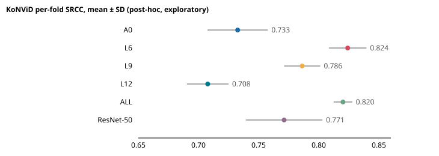

# Post-hoc exploratory follow-up: DINO layers with an extended ridge alpha grid

**Post-hoc, exploratory and unadjusted.** Predeclared in DECISIONS.md on 2026-11-01 (commit `fbe046c`) before any computation. Nothing here changes a frozen configuration, deployed model or phase result. Every number below is generated from the CSV/JSON files in this folder.

Alpha grid: 0.001, 0.01, 0.1, 1, 10, 100, 1000, 10000, 100000, 1e+06 (the original grid ended at 1000).

## Robustness verdict (predeclared rule)

**The L6 finding is robust.** The L6 − ResNet-50 SRCC 95% CI [+0.0406, +0.0787] excludes 0, and the most folds any row placed at the largest grid value (1e6) is 0 of 5 (rule: at most 1), so the edge condition is met.

Original Phase 2 ResNet-50 ridge alphas by fold: 1000, 1000, 1000, 1000, 1000; 5 of 5 folds sat at the original grid edge (1000). Original Phase 1/2 DINO A0 alphas: 1000, 1000, 1000, 1000, 1000.

## KoNViD per-fold results (extended grid)

| Row | SRCC mean ± SD | KRCC mean ± SD | Alphas by fold | Median alpha | Folds at 1e6 |
|---|---|---|---|---|---|
| A0 | 0.733 ± 0.025 | 0.546 ± 0.020 | 1000 1000 1000 10000 1000 | 1000 | 0 |
| L6 | 0.824 ± 0.016 | 0.636 ± 0.015 | 1000 1000 1000 1000 1000 | 1000 | 0 |
| L9 | 0.786 ± 0.015 | 0.596 ± 0.011 | 1000 1000 1000 1000 1000 | 1000 | 0 |
| L12 | 0.708 ± 0.017 | 0.523 ± 0.017 | 1000 10000 1000 1000 1000 | 1000 | 0 |
| ALL | 0.820 ± 0.008 | 0.632 ± 0.007 | 1000 10000 1000 1000 1000 | 1000 | 0 |
| ResNet-50 | 0.771 ± 0.032 | 0.580 ± 0.030 | 1000 10000 1000 1000 1000 | 1000 | 0 |

### Paired bootstrap of pooled out-of-fold predictions (10,000 draws, seed 0, one shared bank; unadjusted)

| A − B | Metric | Δ | 95% CI | PRD §7 classification |
|---|---|---|---|---|
| L6 − A0 | SRCC | +0.0937 | [+0.0707, +0.1178] | A better than B (practically meaningful) |
| L6 − A0 | KRCC | +0.0937 | [+0.0715, +0.1161] | A better than B (practically meaningful) |
| L9 − A0 | SRCC | +0.0554 | [+0.0349, +0.0761] | A better than B (practically meaningful) |
| L9 − A0 | KRCC | +0.0534 | [+0.0343, +0.0724] | A better than B (practically meaningful) |
| L12 − A0 | SRCC | -0.0258 | [-0.0453, -0.0065] | detectable difference, not shown to exceed the margin |
| L12 − A0 | KRCC | -0.0220 | [-0.0391, -0.0047] | detectable difference, not shown to exceed the margin |
| ALL − A0 | SRCC | +0.0863 | [+0.0682, +0.1052] | A better than B (practically meaningful) |
| ALL − A0 | KRCC | +0.0863 | [+0.0693, +0.1036] | A better than B (practically meaningful) |
| A0 − ResNet-50 | SRCC | -0.0345 | [-0.0611, -0.0077] | detectable difference, not shown to exceed the margin |
| A0 − ResNet-50 | KRCC | -0.0304 | [-0.0547, -0.0062] | detectable difference, not shown to exceed the margin |
| L6 − ResNet-50 | SRCC | +0.0592 | [+0.0406, +0.0787] | A better than B (practically meaningful) |
| L6 − ResNet-50 | KRCC | +0.0633 | [+0.0449, +0.0823] | A better than B (practically meaningful) |
| L9 − ResNet-50 | SRCC | +0.0209 | [-0.0013, +0.0437] | no detectable difference (inconclusive at this sample size) |
| L9 − ResNet-50 | KRCC | +0.0230 | [+0.0018, +0.0445] | detectable difference, not shown to exceed the margin |
| L12 − ResNet-50 | SRCC | -0.0603 | [-0.0883, -0.0319] | B better than A (practically meaningful) |
| L12 − ResNet-50 | KRCC | -0.0524 | [-0.0774, -0.0272] | B better than A (practically meaningful) |
| ALL − ResNet-50 | SRCC | +0.0518 | [+0.0319, +0.0731] | A better than B (practically meaningful) |
| ALL − ResNet-50 | KRCC | +0.0559 | [+0.0365, +0.0758] | A better than B (practically meaningful) |

### LIVE-VQC (exploratory; full-KoNViD fit at the median CV alpha; feeds back into nothing)

| Row | Alpha | Videos | SRCC | KRCC | PLCC (logistic-mapped) |
|---|---|---|---|---|---|
| A0 | 1000 | 585 | 0.658 | 0.476 | 0.743 |
| L6 | 1000 | 585 | 0.727 | 0.539 | 0.778 |
| L9 | 1000 | 585 | 0.708 | 0.520 | 0.778 |
| L12 | 1000 | 585 | 0.636 | 0.460 | 0.725 |
| ALL | 1000 | 585 | 0.737 | 0.547 | 0.796 |
| ResNet-50 | 1000 | 585 | 0.644 | 0.460 | 0.706 |

## Limitations

- Post-hoc and exploratory: a follow-up chosen after seeing the grid-edge result; nine unadjusted comparisons per metric.
- The bootstrap captures test-set sampling only, not fold or training variance; LIVE-VQC rows are single fits without intervals.
- The ResNet-50 row is a rerun with the extended grid, not the frozen Phase 2 ridge; the deployed model is unchanged.
