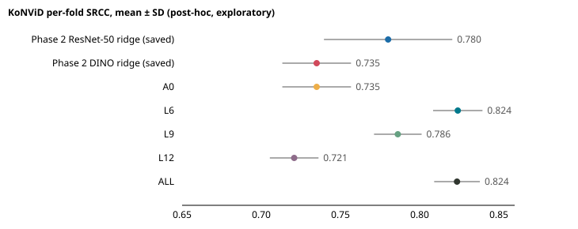
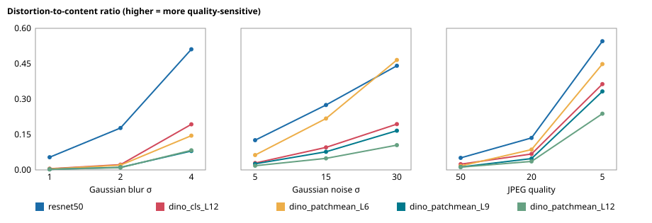

# Post-hoc exploratory analysis: why did DINOv2 lose to ResNet-50 on KoNViD?

**Post-hoc, exploratory and unadjusted.** Predeclared in DECISIONS.md on 2026-10-31 (commit `448efe2`) before any computation. Nothing here changes a frozen configuration, deployed model, phase gate or headline result. Every number below is generated from the CSV/JSON files in this folder.

## Part A: DINO layer variants (ridge, cached features)

A0 reproduction check: maximum per-fold absolute SRCC difference from the saved Phase 1/2 DINO ridge 0 (tolerance 1e-09): **passed**.

| Row | SRCC mean ± SD | KRCC mean ± SD | Median alpha | Folds at grid edge | Gap recovered |
|---|---|---|---|---|---|
| Phase 2 ResNet-50 ridge (saved) | 0.780 ± 0.041 | 0.589 ± 0.038 |  |  |  |
| Phase 2 DINO ridge (saved) | 0.735 ± 0.022 | 0.547 ± 0.018 |  |  |  |
| A0 | 0.735 ± 0.022 | 0.547 ± 0.018 | 1000.0 | 5 | 0% |
| L6 | 0.824 ± 0.016 | 0.636 ± 0.015 | 1000.0 | 5 | 197% |
| L9 | 0.786 ± 0.015 | 0.596 ± 0.011 | 1000.0 | 5 | 114% |
| L12 | 0.721 ± 0.015 | 0.535 ± 0.013 | 1000.0 | 5 | -31% |
| ALL | 0.824 ± 0.014 | 0.637 ± 0.016 | 1000.0 | 5 | 196% |

Gap (saved ResNet-50 ridge minus A0, mean per-fold SRCC): 0.0451. "Closes most of the gap" means recovering more than 50% of it (predeclared).

### Paired bootstrap of pooled out-of-fold predictions (10,000 draws, seed 0, one shared bank; unadjusted)

| A − B | Metric | Δ | 95% CI | PRD §7 classification |
|---|---|---|---|---|
| L6 − A0 | SRCC | +0.0889 | [+0.0657, +0.1126] | A better than B (practically meaningful) |
| L6 − A0 | KRCC | +0.0886 | [+0.0662, +0.1110] | A better than B (practically meaningful) |
| L9 − A0 | SRCC | +0.0506 | [+0.0305, +0.0712] | A better than B (practically meaningful) |
| L9 − A0 | KRCC | +0.0483 | [+0.0295, +0.0672] | A better than B (practically meaningful) |
| L12 − A0 | SRCC | -0.0160 | [-0.0336, +0.0015] | no detectable difference (inconclusive at this sample size) |
| L12 − A0 | KRCC | -0.0135 | [-0.0289, +0.0022] | no detectable difference (inconclusive at this sample size) |
| ALL − A0 | SRCC | +0.0880 | [+0.0709, +0.1059] | A better than B (practically meaningful) |
| ALL − A0 | KRCC | +0.0892 | [+0.0735, +0.1053] | A better than B (practically meaningful) |
| A0 − ResNet-50 | SRCC | -0.0437 | [-0.0697, -0.0178] | B better than A (practically meaningful) |
| A0 − ResNet-50 | KRCC | -0.0406 | [-0.0646, -0.0166] | B better than A (practically meaningful) |
| L6 − ResNet-50 | SRCC | +0.0452 | [+0.0268, +0.0643] | A better than B (practically meaningful) |
| L6 − ResNet-50 | KRCC | +0.0480 | [+0.0297, +0.0668] | A better than B (practically meaningful) |
| L9 − ResNet-50 | SRCC | +0.0069 | [-0.0150, +0.0295] | no detectable difference (inconclusive at this sample size) |
| L9 − ResNet-50 | KRCC | +0.0077 | [-0.0136, +0.0292] | no detectable difference (inconclusive at this sample size) |
| L12 − ResNet-50 | SRCC | -0.0597 | [-0.0873, -0.0316] | B better than A (practically meaningful) |
| L12 − ResNet-50 | KRCC | -0.0541 | [-0.0789, -0.0286] | B better than A (practically meaningful) |
| ALL − ResNet-50 | SRCC | +0.0442 | [+0.0242, +0.0655] | A better than B (practically meaningful) |
| ALL − ResNet-50 | KRCC | +0.0486 | [+0.0288, +0.0687] | A better than B (practically meaningful) |

### LIVE-VQC (exploratory; full-KoNViD fit at the median CV alpha; feeds back into nothing)

| Variant | Alpha | Videos | SRCC | KRCC | PLCC (logistic-mapped) |
|---|---|---|---|---|---|
| A0 | 1000.0 | 585 | 0.658 | 0.476 | 0.743 |
| L6 | 1000.0 | 585 | 0.727 | 0.539 | 0.778 |
| L9 | 1000.0 | 585 | 0.708 | 0.520 | 0.778 |
| L12 | 1000.0 | 585 | 0.636 | 0.460 | 0.725 |
| ALL | 1000.0 | 585 | 0.737 | 0.547 | 0.796 |

## Part B: distortion sensitivity

50 frames from the 20 fixed Phase 0 KoNViD clips, device NVIDIA GeForce RTX 3050 6GB Laptop GPU. Ratio = mean (1 − cosine) clean vs distorted, divided by mean (1 − cosine) between different clean frames.

| Branch | Distortion | Level | Ratio |
|---|---|---|---|
| resnet50 | blur | 1 | 0.054 |
| resnet50 | blur | 2 | 0.178 |
| resnet50 | blur | 4 | 0.514 |
| resnet50 | noise | 5 | 0.127 |
| resnet50 | noise | 15 | 0.277 |
| resnet50 | noise | 30 | 0.444 |
| resnet50 | jpeg | 50 | 0.051 |
| resnet50 | jpeg | 20 | 0.136 |
| resnet50 | jpeg | 5 | 0.548 |
| dino_cls_L12 | blur | 1 | 0.005 |
| dino_cls_L12 | blur | 2 | 0.022 |
| dino_cls_L12 | blur | 4 | 0.194 |
| dino_cls_L12 | noise | 5 | 0.029 |
| dino_cls_L12 | noise | 15 | 0.096 |
| dino_cls_L12 | noise | 30 | 0.195 |
| dino_cls_L12 | jpeg | 50 | 0.024 |
| dino_cls_L12 | jpeg | 20 | 0.068 |
| dino_cls_L12 | jpeg | 5 | 0.366 |
| dino_patchmean_L6 | blur | 1 | 0.004 |
| dino_patchmean_L6 | blur | 2 | 0.020 |
| dino_patchmean_L6 | blur | 4 | 0.146 |
| dino_patchmean_L6 | noise | 5 | 0.063 |
| dino_patchmean_L6 | noise | 15 | 0.219 |
| dino_patchmean_L6 | noise | 30 | 0.468 |
| dino_patchmean_L6 | jpeg | 50 | 0.017 |
| dino_patchmean_L6 | jpeg | 20 | 0.087 |
| dino_patchmean_L6 | jpeg | 5 | 0.451 |
| dino_patchmean_L9 | blur | 1 | 0.002 |
| dino_patchmean_L9 | blur | 2 | 0.011 |
| dino_patchmean_L9 | blur | 4 | 0.081 |
| dino_patchmean_L9 | noise | 5 | 0.026 |
| dino_patchmean_L9 | noise | 15 | 0.077 |
| dino_patchmean_L9 | noise | 30 | 0.167 |
| dino_patchmean_L9 | jpeg | 50 | 0.012 |
| dino_patchmean_L9 | jpeg | 20 | 0.048 |
| dino_patchmean_L9 | jpeg | 5 | 0.334 |
| dino_patchmean_L12 | blur | 1 | 0.002 |
| dino_patchmean_L12 | blur | 2 | 0.010 |
| dino_patchmean_L12 | blur | 4 | 0.083 |
| dino_patchmean_L12 | noise | 5 | 0.018 |
| dino_patchmean_L12 | noise | 15 | 0.049 |
| dino_patchmean_L12 | noise | 30 | 0.105 |
| dino_patchmean_L12 | jpeg | 50 | 0.012 |
| dino_patchmean_L12 | jpeg | 20 | 0.036 |
| dino_patchmean_L12 | jpeg | 5 | 0.239 |

| Branch | Mean ratio over all 9 levels |
|---|---|
| resnet50 | 0.259 |
| dino_patchmean_L6 | 0.164 |
| dino_cls_L12 | 0.111 |
| dino_patchmean_L9 | 0.084 |
| dino_patchmean_L12 | 0.062 |

## Interpretation (against the predeclared question)

Part A: L6, L9, ALL recover more than 50% of the A0→ResNet-50 KoNViD gap, so the predeclared rule reads as **quality information present in earlier DINO layers and lost at the last layer**. The block-12 patch-statistics variant (L12) does not, so the loss is not specific to the CLS token.
Part B supports Part A: the most distortion-sensitive earlier-layer DINO patch-mean branch has a higher mean ratio than the most sensitive block-12 DINO branch (this summary rule was fixed after Part A results, before Part B ran).
Descriptive checks added after Part B ran (not part of any predeclared rule): sensitivity does not fall monotonically with depth (patch-mean L9 is below CLS L12); ResNet-50 is more distortion-sensitive than every DINO branch, yet the best earlier-layer DINO variants outscore it in Part A, so raw distortion sensitivity alone does not explain the Part A ranking. Overall the evidence is **mixed**: Part B is consistent with information loss at block 12 but does not by itself establish it.

## Limitations

- Post-hoc and exploratory: chosen after the Phase 1–3 results; five variants and nine unadjusted comparisons per metric.
- Alpha grid edge: 25 of 25 variant-folds selected the largest grid alpha (1000). As predeclared, the grid was not extended, so every variant (including the original A0) may be under-regularized and the differences could change with a wider grid.
- The bootstrap captures test-set sampling only, not fold or training variance; LIVE-VQC rows are single fits without intervals.
- Nothing here changes the deployed ResNet-50 ridge model or any phase result.
